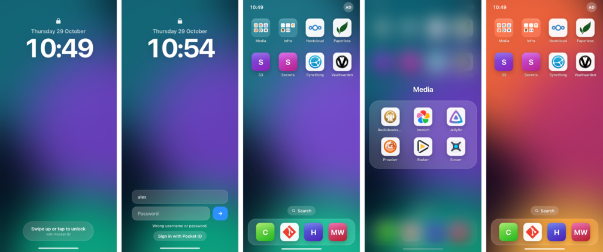
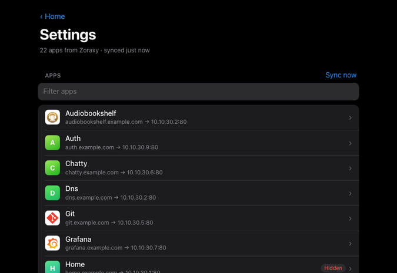

# Zoraxy Home

A [Zoraxy](https://github.com/tobychui/zoraxy) plugin that turns your active HTTP proxy rules into a homepage that looks and feels like an unlocked phone. You get a lock screen, a paged icon grid, folders, a dock, search and a jiggle mode for arranging icons. People sign in with OpenID Connect (Pocket ID, Authentik, Keycloak, Authelia, …) or with a username and password, and each person keeps their own layout.



- **Routes appear on their own.** The plugin reads Zoraxy's proxy rules every 30 s. Enabled rules show up as apps. Disabled rules, wildcard rules and bare IPs are left out.
- **Icons** come from [dashboard-icons](https://dashboard-icons.homarr.dev), looked up by the first label of the domain (`jellyfin.example.com` → `jellyfin`). When there's no match, the app gets a coloured initial tile. Admins can set another slug or an image URL.
- **Sign-in**:
  - **OpenID Connect**: use any provider. Groups come from the `groups` claim.
  - **Local accounts**: admins create accounts with a username, password and groups in Settings. You can use them with or without OIDC.
- **Groups** decide:
  - who may sign in at all (*allowed groups*);
  - who sees which app (per-app groups);
  - who is an admin (*admin group*). Admins open **Settings** from the account sheet to manage apps, accounts, themes and people.
- **Each person keeps their own layout**: icon order, dock, folders and theme, stored on the server.
- **Folders**: drop one app on another in jiggle mode to make one, and drag apps out to remove them. A first-time user gets starter folders grouped by Zoraxy rule **tags** (a tag needs at least two apps).
- **Themes** set the wallpaper (animated soft light, gradient, solid or image, with dimming), text appearance, font, accent colour, icon shape, icon tile style and labels.
  - Eight themes are built in.
  - Admins create their own with a live preview and optional custom CSS, and pick the default.
- **Blocking** someone only locks them out of this homepage.

## Install

### From the plugin store

In Zoraxy, open **Plugins → Plugin Store**, install **Home** and enable it. Accept the one permission it asks for: `GET /plugin/api/proxy/list`, which reads the proxy rules.

### Manually

Download the binary for your platform from the [latest release](https://github.com/denMaier/zoraxy-home/releases/latest) and place it in Zoraxy's plugin directory, in a folder with the same name as the binary:

```sh
mkdir -p /opt/zoraxy/plugins/zoraxy-home
curl -L -o /opt/zoraxy/plugins/zoraxy-home/zoraxy-home \
  https://github.com/denMaier/zoraxy-home/releases/latest/download/home_linux_amd64
chmod +x /opt/zoraxy/plugins/zoraxy-home/zoraxy-home
```

Restart Zoraxy, or rescan plugins, then enable **Home** under *Plugins*.

If Zoraxy runs in Docker, put the plugin folder into the mounted `plugins` directory. The homepage then listens inside the Zoraxy container, so the `127.0.0.1:8099` upstream below still works.

## Set up

1. **Add a proxy rule for the homepage** in Zoraxy, e.g. `home.example.com` → `127.0.0.1:8099`. The homepage listens there by default.
2. **Open the plugin page** in Zoraxy (*Plugins → Home*) and set **Homepage URL** to `https://home.example.com`.
3. **Choose how people sign in.** You can turn on both.
   - **OIDC.** In your provider, register a client with the callback URL `https://home.example.com/auth/callback`. Set its logout redirect to `https://home.example.com/`. Then fill in **Issuer**, **Client ID** and **Client secret**. Use **Test discovery** to check the provider is reachable, then **Save**. The Zoraxy host must reach the issuer over HTTPS.
   - **Username and password.** Turn on **Password sign-in** and **Save**, then add accounts under **Accounts**.
4. **Set the admin group** (default `home_admins`):
   - with OIDC, create the group in your provider and add yourself;
   - with local accounts, tick the group on your account.
5. **Unlock the homepage.** Members of the admin group find **Settings** in the account sheet.



## Using it

| Action | How |
|---|---|
| Change page | Swipe, scroll the mouse wheel, ← / →, or click the dots |
| Search | Start typing, press `/`, `⌘K`, click the Search pill, or swipe down |
| Folders | In jiggle mode, drop an app onto the centre of another app or folder. Tap a folder to open it; in jiggle mode you can rename it there. Drag an app out and hold for a moment to take it back to the home screen. |
| Rearrange | Long-press or right-click an icon. While icons jiggle, drag them between pages (hold at a screen edge to flip) or onto or off the dock. Tap **Done** or press Esc. |
| Theme, sign out, settings | Tap your avatar |
| Open in a new tab | ⌘/Ctrl-click |

## Security notes

- **The plugin settings page** (`/ui/`, which holds the OIDC secret) listens only on `127.0.0.1`, on the port Zoraxy assigns. You reach it through Zoraxy's authenticated admin panel. Admins on the homepage get the same page at `/settings/`, without the OIDC fields.
- **Sessions** are HMAC-signed cookies (`HttpOnly`, `SameSite=Lax`, `Secure` when the homepage URL is https) and last 14 days.
  - Each request is checked against the stored user. Blocking someone, deleting their account or changing their password takes effect immediately.
  - State-changing requests need an `X-Requested-With` header.
- **Passwords** are hashed with bcrypt and stored in `data/accounts.json` (mode 0600).
  - Failed sign-ins are limited to 5 per username and 10 per client IP in 15 minutes.
  - The client IP comes from Zoraxy's `X-Forwarded-For`/`X-Real-IP`, and only for requests from loopback.
- **Other data files.** `data/config.json` holds the OIDC client secret and session key (mode 0600). `data/users.json` holds profiles and layouts.
- **The homepage sends a strict CSP**: no inline scripts. Images may come from anywhere so that icons can load.
- **Icons and privacy.** Icons are loaded by the visitor's browser from the jsDelivr CDN. Admins can point an app at a self-hosted image instead.
- **Custom theme CSS** is admin-only. The CSP still blocks scripts, and wallpaper URLs are validated.
- **The plugin API key** is passed by Zoraxy on the command line, so it is visible in the host's process list.

## Development

| Path | What |
|---|---|
| `main.go` | Plugin introspection, plugin UI listener, homepage listener |
| `routes.go` | Polls Zoraxy for proxy rules |
| `auth.go` | OIDC (PKCE + nonce), signed session cookies, RP-initiated logout |
| `accounts.go` | Local accounts, bcrypt, sign-in rate limiting |
| `server.go` | Homepage and admin HTTP handlers, app catalog and visibility rules |
| `themes.go` | Built-in themes and validation of custom ones |
| `config.go`, `users.go` | JSON persistence in `./data` (in the plugin folder) |
| `web/home` | Home screen (vanilla JS, no build step) |
| `web/admin` | Settings page |
| `mod/zoraxy_plugin` | Copied from Zoraxy `src/mod/plugins/zoraxy_plugin` |

```sh
make test           # go vet + unit tests
make build          # ./zoraxy-home for this machine
make release        # dist/release/home_<os>_<arch> for every store platform
make introspect     # regenerate .introspect after changing the plugin metadata
```

To release, bump the version in `main.go` and run `make introspect`. Commit, then push a matching tag such as `v0.2.0`. The release workflow builds the binaries and attaches them to a GitHub release. The plugin store reads `.introspect` and `.releaseurl` from this repository.

## License

[AGPL-3.0](LICENSE), the same as Zoraxy and its plugin library.
